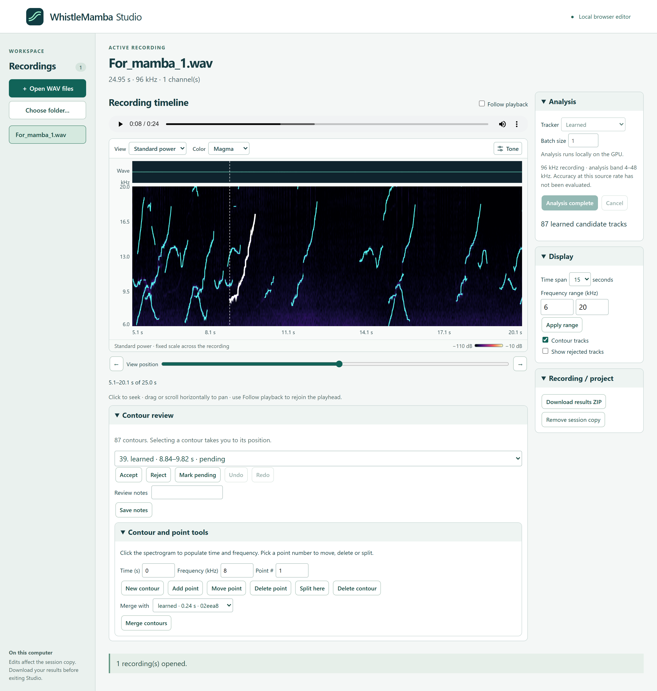

# WhistleMamba Studio

WhistleMamba Studio traces candidate whistles in WAV recordings. You can inspect and edit each contour on a scrolling spectrogram, then export its time–frequency points or a Raven selection table.

[Download WhistleMamba Studio for Windows](https://github.com/shashidhar1801/WhistleMamba-Studio/releases/download/v0.2.0b2/WhistleMamba-Studio-0.2.0b2-Windows-x64-field-examples.zip) · [Download the narrated Windows video guide (MP4)](https://github.com/shashidhar1801/WhistleMamba-Studio/releases/download/v0.2.0b2/WhistleMamba_Studio_Windows_Screen_Guide.mp4)

WhistleMamba combines a four-stage Mamba-2 encoder with a decoder that preserves fine spectrogram detail. The encoder scans in both directions along time and, in deeper stages, along frequency. This gives the learned tracker both local detail and surrounding context when linking points into candidate contours, especially where whistles bend or cross.

On Windows, Studio uses a local NVIDIA GPU through CUDA in WSL 2 to compute spectrogram features and run the model in four-second windows. Your recordings stay on your computer.

[Download the narrated Windows video guide (MP4)](https://github.com/shashidhar1801/WhistleMamba-Studio/releases/download/v0.2.0b2/WhistleMamba_Studio_Windows_Screen_Guide.mp4) · Run the detector, edit a contour and export the results.

*Reviewing the first of the four included recordings, For_mamba_1.wav.*

## Run the Windows detector

1. Download the **[Windows ZIP with model and four example WAVs](https://github.com/shashidhar1801/WhistleMamba-Studio/releases/download/v0.2.0b2/WhistleMamba-Studio-0.2.0b2-Windows-x64-field-examples.zip)** from [Releases](https://github.com/shashidhar1801/WhistleMamba-Studio/releases). Extract the entire ZIP to a writable local folder. The GitHub source ZIP does not include the Windows launchers or weights.
2. Use 64-bit Windows, Chrome and an NVIDIA GPU accessible to WSL 2. The Linux distribution must be named `Ubuntu-24.04`, with x86-64 Python 3.12 and its venv module. For a new PC, follow [Start Here](START%20HERE.txt).
3. Open **Configure Detector.exe**. Select **Install / check runtime**. When it finishes, use **Browse** to select `model/WhistleMamba-CSR01-joint-base-e12.safetensors`, then **Verify and save model**. Continue when **Detector ready on** names your GPU.
4. Open **WhistleMamba Browser.exe**. Click **Open WAV files**, choose `examples/For_mamba_1.wav`, then select the recording in the list. Set **Tracker → Learned** and **Batch size → 1**, click **Run analysis**, and wait for **Analysis complete**.
5. Select a contour to inspect it. Under **Recording / project**, choose **Download results ZIP**. Open `raven_selections.txt` for one row per exported contour or `contours.csv` for its individual points. Save your results before choosing **Exit Studio** from the Windows notification area.

## Recordings and user guide

The [four example recordings](examples/) are mono, 96 kHz WAVs. The [illustrated user guide (PDF)](guide/WhistleMamba_Studio_User_Guide.pdf) uses the first recording to demonstrate navigation, display settings, contour editing and export. An [editable Word guide](guide/WhistleMamba_Studio_User_Guide.docx) is also included.

For your own recordings, use WAV files at least four seconds long, at exactly 96 kHz or between 192 and 768 kHz. At 96 kHz the detector uses the 4–48 kHz band. A candidate contour is a trace to review, not a confirmed whistle.

## Source and licenses

Browse the [editor](app/whistlemamba_studio/), [detector](app/whistlemamba/), [Windows launchers](launcher-source/), and [runtime installer](runtime/). See the [model description](MODEL_CARD.md) and [privacy information](PRIVACY.md).

- Original software: [Apache License 2.0](LICENSE).
- CSR01 epoch-12 inference weights: Shashidhar Siddagangaiah (2026), [CC BY-ND 4.0](model/MODEL_WEIGHTS_LICENSE.txt).
- Field recordings: [audio permissions](examples/AUDIO_NOTICE.txt).
- Dependencies: [third-party notices](THIRD_PARTY_NOTICES.md).
